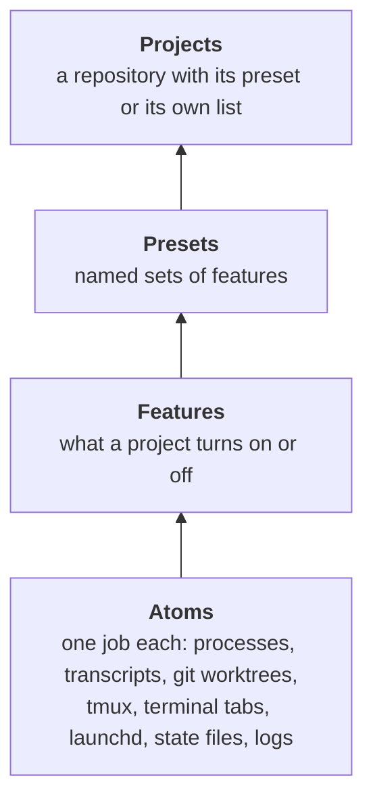

# Contributing to porchlight

Thank you for helping. porchlight is small on purpose: the Python standard library only, a
macOS tool installed with Homebrew, and behavior a person can predict from the README and `docs/`.

## Before you write code

- For a bug, open an issue with the bug report template: `porchlight --version`, and the
  output of `porchlight doctor` and `porchlight status`, say most of what is needed.
- For a new feature or a change of behavior, open an issue first and describe the problem
  it solves for someone driving sessions from the phone.
- Security problems go through [SECURITY.md](SECURITY.md), not public issues.

## Working on the code

```sh
git clone https://github.com/alejandrovdev/porchlight.git
cd porchlight
python3 -m unittest discover -s tests -t .
python3 -m porchlight --help
```

Python 3.11 or later, nothing to install. The tests stand in for processes, folders, tmux,
git and the tab opener: they need no network, no Claude account and no terminal of yours,
and they run in a few seconds, apart from `tests/test_terminal.py`, which runs `setup` in a
pseudo-terminal it makes (its screens, keys, colors and resizes) and takes about ten.

To try a change against the real Mac without touching an install you use, follow
[A rehearsal apart from a real install](#a-rehearsal-apart-from-a-real-install).

### How the code is laid out

The package is built in layers. An atom knows nothing of features; a feature declares what
it needs and does nothing when it is off; presets name sets of features; a project picks a
preset or its own list. Keep a new piece in the lowest layer that can hold it.



| Where | What |
| --- | --- |
| `porchlight/atoms/` | the atoms: processes, transcripts, worktrees, tmux, terminal tabs, launchd, state files, logs, file watching |
| `porchlight/features/` | `server`, `ready_sessions` (`ready-session`, `tabs`, `reopen`), `view_tabs` and `live_view` (`live-view`), `resume_list`, `keep_awake` |
| `porchlight/config.py` | the feature table, the presets and the configuration file |
| `porchlight/passes.py`, `service.py` | one pass over the projects, and the service that runs passes |
| `porchlight/agents.py` | the login agents: `apply`, `start`, `stop`, `uninstall` |
| `porchlight/linking.py`, `answers.py`, `screens.py`, `ui/` | `setup`, `init`, `deinit` and the terminal interface |
| `porchlight/doctor.py`, `cli.py`, `names.py`, `mac.py` | the checks, the command line, every name the tool creates, and the Mac as the features see it |

### A rehearsal apart from a real install

The [environment variables](docs/configuration.md#environment-variables) move everything
porchlight names, so a rehearsal never touches an installed copy's files, agents or tmux
server:

```sh
scratch=$(mktemp -d)
export PORCHLIGHT_CONFIG="$scratch/config.toml" PORCHLIGHT_STATE_DIR="$scratch/state" \
  PORCHLIGHT_LOG_DIR="$scratch/logs" PORCHLIGHT_LAUNCH_AGENTS_DIR="$scratch/agents" \
  PORCHLIGHT_LABEL=test.porchlight.rehearsal PORCHLIGHT_TMUX_SERVER=porchlight-rehearsal
porchlight doctor
```

`porchlight` is the installed command; from a clone, `python3 -m porchlight` runs the code
of that clone instead. Keep `PORCHLIGHT_TRANSCRIPTS_DIR` at its default, or porchlight
cannot find Claude Code's transcripts. Run from inside a porchlight session, first
`unset TMUX TMUX_PANE`, so that nothing reaches the tmux server of that session.

Whatever these variables say is handed on to the agents, tabs and sessions porchlight
starts, with folders and files made absolute. The rehearsal is still real where it acts:
`init`, `apply` and `start` load agents into your launchd under the label you chose, its
sessions use your Claude Code account and show in your app, and they need the repository
you link to be trusted by Claude Code (run `claude` in it once). End it with `porchlight
deinit <folder>` and `porchlight uninstall --servers --purge` under the same variables.

## How a change is made

- **Test first.** Write the test that shows the problem or the new rule, see it fail, then
  make it pass. Test through the public functions and assert every observable effect:
  output, exit code, files written.
- **Keep what exists.** A change that touches a command or option others use keeps a test
  proving its old behavior still holds.
- **Docs travel with the code.** A new command, option, message or configuration key
  updates the help text, the README or `docs/`, and the `Unreleased` section of
  [CHANGELOG.md](CHANGELOG.md).
- **No dependencies.** Only the standard library, so Homebrew installs porchlight with its
  Python and nothing else.

## Commits and pull requests

- Commits follow [Conventional Commits](https://www.conventionalcommits.org/): `feat(doctor): ...`,
  `fix(server): ...`, `docs: ...`, written in English, in the imperative, saying what changes
  for the person using porchlight.
- One pull request per unit of behavior, with its tests and docs. Over about 400 changed
  lines, split it into pull requests that build on each other.
- Continuous integration runs the tests on macOS with Python 3.11 and 3.15; both must pass.
  On 3.15 it also measures which lines the tests run, with the standard library's `trace`,
  lists the least covered modules, and fails under 90 percent.

## Compatibility

From 1.0.0 the interface in [Compatibility](README.md#compatibility) changes only in a major
release. A pull request that would break it says so in its title and in the changelog.

By contributing you agree that your contribution is licensed under the
[MIT License](LICENSE).
