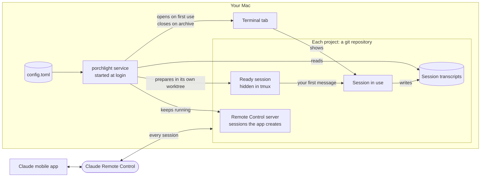
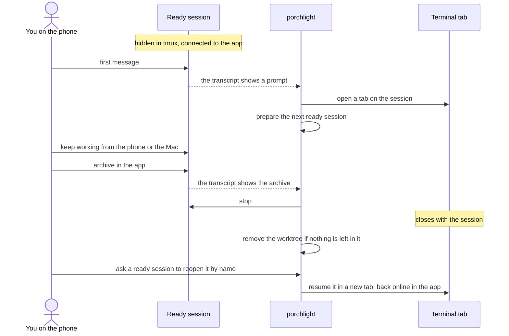
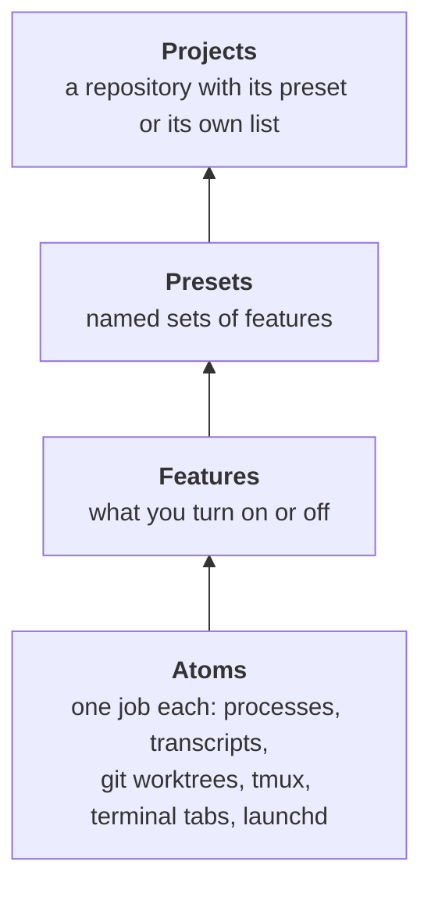

# porchlight

Leave a light on for your phone: porchlight keeps Claude Code sessions ready on your Mac so
you can start, follow and close them from the Claude mobile app.

> **Status: in development.** Nothing here is ready to install yet. This page describes how
> it works and what the first version will include.

## The problem it solves

Claude Code's Remote Control lets you drive a session that runs on your Mac from the Claude
mobile app. On its own it leaves four gaps when the phone is the only thing in your hands:

| Without porchlight | With porchlight |
| --- | --- |
| The app cannot start a session that has Claude Code's own interface. Someone has to open a terminal on the Mac first. | A session is always waiting, already connected. You write in it and work starts. |
| A session the app creates through the Remote Control server has no window. On the Mac there is nothing to look at or type in. | A session you use gets a terminal tab, and a session the server started gets a read-only tab that follows it. |
| Archiving a session in the app does not end it on the Mac. Processes, tabs and worktrees pile up. | Archiving closes the tab, ends the session and removes its worktree when nothing is left in it. |
| Unarchiving in the app does not bring a session back online. | You ask for it by name from the phone and it comes back in a new tab. |

It serves one project or several, and each one runs only the features you turn on.

## How it works

porchlight is a small service that starts when you log in. It reads one configuration file,
keeps the sessions of each project running, and follows what happens in them by reading the
transcripts Claude Code writes. It never talks to Claude's servers itself: every session is
an ordinary `claude` process, connected through Remote Control.



### The life of a session



Each session works in its own git worktree, so two tasks never share files. A worktree with
uncommitted or unmerged work is never removed: it stays where it is for you to pick up.

### Built in layers

The code is organized so that you install only what you use:



| Feature | What you get | Needs |
| --- | --- | --- |
| `server` | The app creates sessions on the Mac, each in its own worktree | Claude Code, git |
| `ready-session` | A session with Claude Code's interface is always ready to write in | Claude Code, git, tmux |
| `tabs` | A terminal tab opens when a session is used and closes when it is archived | `ready-session`, a supported terminal |
| `live-view` | A read-only tab follows a session the server started | `server`, `tabs` |
| `reopen` | A closed session comes back by name, asked from the phone | `ready-session` |
| `resume-list` | The server's sessions appear in `/resume` | `server` |
| `keep-awake` | The Mac stays awake on AC power while porchlight runs | nothing |

The presets are `minimal` (`server`) and `recommended` (all of them).

## Configuration

One file, `~/Library/Application Support/porchlight/config.toml`, written by the setup and
editable by hand:

```toml
terminal = "warp"

[projects.shop]
path = "~/Projects/shop"
permission_mode = "manual"
preset = "recommended"

[projects.blog]
path = "~/Projects/blog"
permission_mode = "plan"
features = ["server", "resume-list"]
```

`permission_mode` is the mode Claude Code starts each session in. No mode is assumed: you
choose it for each project.

## Requirements

- A Mac with [Homebrew](https://brew.sh).
- Claude Code, signed in with a plan that includes Remote Control, and the Claude mobile
  app.
- git, tmux and Python 3.11 or later (Homebrew installs them).
- Warp, for the features that open tabs. Other terminals are planned.

## Development

```sh
python3 -m unittest discover -s tests -t .
```

The code uses the Python standard library only. Tests need no network, no Claude account
and no terminal.
