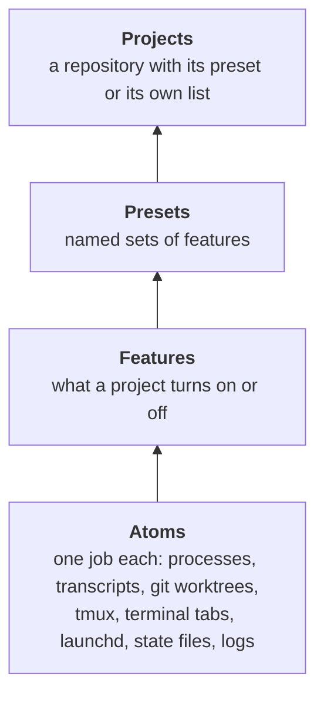

# porchlight

Leave a light on for your phone: porchlight keeps Claude Code sessions ready on your Mac so
you can start, follow and close them from the Claude mobile app.

> **Status: early.** porchlight works and is used every day, but while its version starts
> with 0, commands and the configuration file may still change between minor releases (see
> the [changelog](CHANGELOG.md)).


Contents: [The problem it solves](#the-problem-it-solves) ·
[Requirements](#requirements) · [Install](#install) · [Quick start](#quick-start) ·
[Linking and unlinking folders](#linking-and-unlinking-folders) ·
[How it works](#how-it-works) · [Features and presets](#features-and-presets) ·
[Configuration](#configuration) · [Commands](#commands) ·
[Running and stopping](#running-and-stopping) · [Security and privacy](#security-and-privacy) ·
[Troubleshooting](#troubleshooting) · [Uninstall](#uninstall) · [Development](#development) ·
[License](#license)

## The problem it solves

Claude Code's Remote Control lets you drive a session that runs on your Mac from the Claude
mobile app. On its own it leaves four gaps when the phone is the only thing in your hands:

| Without porchlight | With porchlight |
| --- | --- |
| The app cannot start a session that has Claude Code's own interface. Someone has to open a terminal on the Mac first. | A session is always waiting, already connected. You write in it and work starts. |
| A session the app creates through the Remote Control server has no window. On the Mac there is nothing to look at or type in. | A session you use gets a terminal tab, and a session the server started gets a read-only tab that follows it. |
| Archiving a session in the app does not end it on the Mac. Processes, tabs and worktrees pile up. | Archiving closes the tab, ends the session and removes its worktree when nothing in it would be lost. |
| Unarchiving in the app does not bring a session back online. | You ask for it by name from the phone and it comes back in a new tab. |

It serves one project or several, and each one runs only the features you turn on.

## Requirements

- A Mac with [Homebrew](https://brew.sh).
- Claude Code 2.1.92 or later (2.1.327 or later recommended: it stops a server in worktree
  mode without touching its sessions' ignored files), with `claude` in your `PATH`, signed
  in with a claude.ai account on a plan that includes Remote Control: Pro, Max, Ultra,
  Team or Enterprise (on Team and Enterprise an owner turns it on first). Remote Control
  does not work with an API key: with `ANTHROPIC_API_KEY`, `apiKeyHelper` or
  `ANTHROPIC_AUTH_TOKEN` set it stays off. When Claude Code is missing, `setup` can install
  it with Homebrew (`brew install --cask claude-code`); you still sign in by running
  `claude` once. Homebrew formulas cannot depend on casks, so the formula does not
  install it. `claude --version` says which version you have.
- The Claude mobile app, signed in to the same account.
- git: the one in Apple's Command Line Tools or Homebrew's.
- tmux and Python 3.11 or later. The Homebrew formula installs both.
- A terminal for the features that open terminal tabs (`tabs` and `live-view`):
  [Warp](https://www.warp.dev), or Terminal, the app macOS comes with. Without one you can
  still use every other feature.

## Install

```sh
brew install alejandrovdev/porchlight/porchlight
porchlight --version
```

The tap is `alejandrovdev/porchlight`. Installing adds the `porchlight` command; nothing
runs in the background until you link a folder with `porchlight init`.

## Quick start

1. Set up this Mac once:

   ```sh
   porchlight setup
   ```

   Keep the recommended features it starts with: the next steps need `ready-session` and
   `tabs`.

2. Link a project. Go to its folder (a git repository) and run `init`:

   ```sh
   cd ~/Projects/shop
   porchlight init
   ```

   Then run `porchlight doctor`: each line should say `ok`. The service looks at every
   project every 20 seconds, so the ready session follows within about half a minute.

3. **On the phone**, open the Claude app. The ready session appears in your session list;
   its name starts with the project's name (`shop`). Write in it and work starts.
4. **On the Mac**, with your terminal running, a tab opens on that session soon after your
   first message, and porchlight prepares the next ready session. Archiving the session in
   the app ends it and closes its tab (in Terminal, when its profile closes windows: see
   [A tab does not open](docs/troubleshooting.md#a-tab-does-not-open)).
5. See every project's sessions:

   ```sh
   porchlight status
   ```

   ```text
   shop
     Ready sessions, with Claude Code's interface:
       5f0c9e21  free     2026-11-24 09:41  5f0c9e21  (pid 48211, cse_01Hq7c, hidden)
       a83d2b7c  used     2026-11-24 09:12  Fix the checkout total  (pid 47102, cse_01Xk2m)
     Sessions the server started, with a read-only view:
       No session the server started is running.
   ```

With the `server` feature on, you can also create new sessions on this Mac from the app.

### What `setup` asks

1. **Prerequisites**: Claude Code, git, tmux and each supported terminal app, each marked
   `ok` or `missing` with what to do about it. Nothing is installed from here. When Homebrew
   is there and something it installs is missing (Claude Code, git, tmux or Warp), the
   screen ends with a warning: the next screen can install them, which downloads software
   from the internet, a cask may ask for your password, and Claude Code still needs you to
   sign in by running `claude`.
   - **Install what is missing**: asked only then. `Install with Homebrew` lists the
     `brew install` commands it runs; `Skip` (where it starts) leaves them to you
     (`porchlight doctor` lists them). Nothing is installed yet: the summary lists the
     installs, and they run only after you answer `y` there, before the configuration is
     saved, each with Homebrew's own output. A failed install is said, the others go on,
     and `setup` exits with 1.
2. **Terminal**: the app tabs open in (Warp, or Terminal), marked installed or not
   installed, or `None`: no tab opens and sessions run hidden. `None` is offered only while
   no linked project has `tabs`; a project linked later with `tabs` asks for a terminal.
3. **Default permission mode**: one of the modes your installed `claude --help` lists. When
   they cannot be read, you type one.
4. **Default features**: a checklist of the [features](#features-and-presets). Turning one
   on turns on what it needs; turning one off turns off what needs it, and says why.
5. **Keep the Mac awake**: `On AC power and on battery` (the default) or `Only on AC
   power`. Asked only when the default features or a linked project have `keep-awake`.
6. **Summary**: what is about to be saved, and `Save this configuration?`. `y` saves it;
   `n` changes nothing.

### What `init` asks

1. **Project name**: filled in from the folder's name. Lowercase letters, digits and
   hyphens, at most 32.
2. **Permission mode**: starts from the default you chose in `setup`.
3. **Features**: start from the default features.
4. **Terminal**: only when the features open tabs and no terminal is set yet.
5. **Summary**: `Link this folder?`, or `Replace its settings?` for a folder already linked
   (`Rename it?` when you changed its name).

The screens are drawn when your terminal can draw them: up and down move, Enter chooses,
Space turns a feature on or off, Esc goes back, `q` quits (Ctrl-C in a text field).
Otherwise they are numbered questions: type the number or the answer and press Enter, `<`
goes back, `q` or Ctrl-C quits. Quitting, or answering no at the summary, changes nothing
(exit code 1).

In a terminal with 256 colors and UTF-8 that is at least 80 columns by 24 rows, every step
is a whole screen: a status bar with a progress bar, the name in large pixels, the steps,
the options in a panel with a bar under the cursor, and a panel about the option the
cursor is on (what it does, what it needs and what needs it). From 112 columns by 32 rows
an old porch lantern moves beside them and your answers so far are listed under the name.
A smaller terminal gets plain lines: the title, the keys and the options. With fewer
colors only the title and errors are colored. Set `NO_COLOR` to any value to draw plain
lines without colors.

## Linking and unlinking folders

### `porchlight init [folder]`

- Links the git repository a folder is in. Run it at the top of the repository or in any
  folder inside it: the project is always the repository's top folder. Without `folder`,
  it uses the current one.
- Outside a git repository it refuses and changes nothing:

  ```text
  ~/notes is not in a git repository, and the features need one: run `git init` in it first. Nothing was changed.
  ```

- In a folder that is linked already, it edits that project: the screens start from its
  current values. Its folder stays as it is written in the configuration. A new name
  renames that project; to link another repository, run `init` in that repository's folder
  (or pass it: `porchlight init ~/path/to/repository`).
- After saving, it brings the background agents up to date the way `apply` does: a
  server that is running is left as it is.

Flags answer the screens beforehand, so `init` can run without asking anything:

```sh
porchlight init ~/Projects/shop --name shop --permission-mode plan --preset recommended --terminal warp --yes
```

| Flag | Answers |
| --- | --- |
| `--name <name>` | the project's name |
| `--permission-mode <mode>` | its permission mode; one that `claude --help` lists |
| `--preset <name>` or `--feature <feature>` | its features: a preset, or each feature with its own `--feature`, including the features each one builds on |
| `--terminal warp` or `--terminal apple-terminal` | the terminal, for all projects |
| `--base <branch>` | the branch new worktrees start from (no screen asks for it) |
| `--yes` | every other screen takes the value it starts from, and the summary is confirmed |

Even with `--yes`, a screen that no flag answers and that has no value to start from (no
default permission mode yet, for example) is still asked. With no terminal to ask on, the
command stops with exit code 2 and names the flag, for example
`nothing answered "Permission mode": give --permission-mode`. A list of features that
leaves one out is refused the same way: `argument --feature: "tabs" needs "ready-session"`.

### `porchlight deinit [folder]`

Unlinks the project of a folder: its top folder or any folder inside it. It first prints
everything it is about to do, then:

- removes the project from the configuration;
- ends its free ready session, if one waits;
- unloads and removes its server's background agent, if it has one: **the sessions that
  server started end**;
- unloads and removes the service too when no project is left;
- removes what it kept in its state, once nothing of the project runs, and only in a state
  folder porchlight made (when it says porchlight did not make that folder, it removed
  nothing there).

It leaves as they are: the sessions in use (it says how to reach each), the project's
worktrees, its logs, and the running servers of other projects.

It asks for confirmation only when its server is running sessions, because they end and the
app cannot start them again. Where it cannot ask (no terminal), it refuses unless you give
`--yes`:

```sh
porchlight deinit ~/Projects/shop --yes
```

If the server cannot be unloaded, the project stays in the configuration and the exit code
is 1: run `deinit` again.

### `porchlight setup`

`setup` changes the terminal and the `[defaults]` that new projects start from; linked
projects keep their own values. It takes the same flags as `init`, except `--name` and
`--base`, and also `--keep-awake always|plugged-in` and `--install-missing`; its
`--terminal` also takes `none`, which leaves `terminal` out of the configuration:

```sh
porchlight setup --terminal warp --permission-mode plan --preset recommended --yes
```

`--yes` alone installs nothing. Add `--install-missing` to install what is missing with
Homebrew, as the **Install what is missing** screen does:

```sh
porchlight setup --terminal warp --permission-mode plan --install-missing --yes
```

When nothing is missing it says so. When something is missing but Homebrew is not found,
it says that nothing was installed and why, saves the rest, and exits with 1.

When projects are already linked, it brings their agents up to date afterwards, as `apply`
does.

## How it works

porchlight runs as a service, `porchlight run`, under a login agent: launchd starts it when
you log in and starts it again if it ends. It reads the configuration file, keeps the
sessions of each project running, and follows what happens in them by reading the
transcripts Claude Code writes. Each project with the `server` feature has a login agent of
its own, which runs that project's Remote Control server
(`porchlight server <project> --permission-mode <mode>`) in its repository. porchlight never
talks to Claude's servers itself: every session is an ordinary `claude` process, connected
through Remote Control.

The diagrams, the life of a session from the moment it waits to the moment it is archived,
and what happens to each worktree are in [How porchlight works](docs/how-it-works.md).

## Features and presets

| Feature | What you get | Needs |
| --- | --- | --- |
| `server` | The app creates sessions on the Mac, each in its own worktree | Claude Code, git |
| `ready-session` | A session with Claude Code's interface is always ready to write in | Claude Code, git, tmux |
| `tabs` | A terminal tab opens when a session is used and closes when it is archived | `ready-session`, a supported terminal |
| `live-view` | A read-only tab follows a session the server started | `server`, `tabs` |
| `reopen` | A closed session comes back by name, asked from the phone | `ready-session` |
| `resume-list` | The server's sessions appear in `/resume` | `server` |
| `keep-awake` | The Mac stays awake while porchlight runs, on AC power and on battery | nothing |

The presets are `minimal` (`server`) and `recommended` (all seven).

- **`server`**: the app creates sessions in the repository through Claude Code's Remote
  Control server, each in its own worktree, `.claude/worktrees/bridge-cse_<id>`. Once a
  session ended, porchlight removes its worktree if it is clean and its HEAD is on the base
  branch, and leaves it otherwise, saying why in the project's log; a worktree locked by
  anything but an ended Claude Code process is left locked (see
  [How porchlight works](docs/how-it-works.md#the-life-of-a-session)). The worktree's
  branch is deleted with `git branch -d` only when every commit of it is on the base
  branch.
- **`ready-session`**: the session waits hidden in porchlight's own tmux server
  (`tmux -L porchlight`), apart from any tmux you run. Its name in the app starts with the
  project's session prefix, which is the project's name unless you set `session_prefix`.
  Turning the feature off ends the session that waits; sessions in use are followed until
  they end.
- **`tabs`**: tabs open in the terminal you chose, and only while it is running:
  porchlight never starts it. In Warp each session gets a tab; in Terminal, a window.
  A tab's title is the session prefix and the session's title or first prompt. Without
  `tabs`, a session in use keeps running hidden, and `porchlight status` prints the command
  that shows it in a terminal.
- **`live-view`**: the tab runs `porchlight view <project> <session>`. Nothing typed there
  reaches the session; it closes by itself when the session is archived. A view tab you
  close is not opened again.
- **`reopen`**: each ready session is told, beside its system prompt, how to run
  `porchlight reopen`. Write "reopen" and the session's name in a ready session and it
  reopens that one, in a new tab, back online in the app. On the Mac,
  `porchlight reopen` lists the closed sessions and `porchlight reopen <name>` reopens one
  (by its title, its first prompt, part of either, or its id). The session runs that
  command itself, so its permission mode may ask you first. A closed session is remembered
  for 30 days. In a project without `tabs`, it comes back hidden in tmux.
- **`resume-list`**: Claude Code's `/resume` leaves out the sessions that did not start in a
  terminal, the server's among them. porchlight keeps a copy of each in the session folder
  of the repository's top folder, where `/resume` lists it. A copy is a separate session:
  continuing it in the terminal does not reach the phone. A copy you continued is never
  overwritten; what the phone adds afterwards goes to a new one.
- **`keep-awake`**: while the service runs and any project has this feature, the Mac does
  not go to sleep while idle, on AC power or on battery (`caffeinate -i -s`). The display
  still sleeps. On battery, closing the lid still puts the Mac to sleep: macOS decides
  that, so keep the lid open or the Mac plugged in. On battery it drains the battery
  faster. To keep it awake on AC power only (`caffeinate -s`), choose `Only on AC power`
  in `setup`, or set `keep_awake = "plugged-in"`; the service picks up the change by itself.

## Configuration

One file, written by `setup` and `init` and editable by hand:

```text
~/Library/Application Support/porchlight/config.toml
```

Every command takes `--config <file>` to use another one, and the `PORCHLIGHT_CONFIG`
variable moves the default. A full example:

```toml
terminal = "warp"

[defaults]
permission_mode = "plan"
preset = "recommended"

[projects.shop]
path = "~/Projects/shop"
permission_mode = "manual"
preset = "recommended"
base = "main"
session_prefix = "Shop"

[projects.blog]
path = "~/Projects/blog"
permission_mode = "plan"
features = ["server", "resume-list"]
```

### Top level

| Key | Type | Rules |
| --- | --- | --- |
| `terminal` | text | The app tabs open in: `"warp"` or `"apple-terminal"` (Terminal). Required when any project has `tabs`; left out when `setup` is answered `None`. |
| `keep_awake` | text | Optional. When `keep-awake` holds the Mac awake: `"always"` (the default: on AC power and on battery) or `"plugged-in"` (on AC power only). One setting for the Mac. |
| `[defaults]` | table | Optional. What `init` starts from for a new project. |
| `[projects.<name>]` | table | One per project. |

### `[defaults]`

Each key is optional. Projects do not inherit these values: they only fill in the screens
of `init` for a folder linked from then on.

| Key | Type | Rules |
| --- | --- | --- |
| `permission_mode` | text | One word. |
| `preset` | text | `minimal` or `recommended`. Not together with `features`. |
| `features` | list of text | Feature names, including the features each one builds on. Not together with `preset`. |

### `[projects.<name>]`

The name has lowercase letters, digits and hyphens, starts with a letter or a digit, and is
at most 32 characters long.

| Key | Type | Required | Rules |
| --- | --- | --- | --- |
| `path` | text | yes | The repository's top folder, absolute or starting with `~/`; a relative path is refused, since the agents do not run from your folder. One project per folder. `init` writes the full path. |
| `permission_mode` | text | yes | One word: the mode Claude Code starts each of the project's sessions in. `doctor` checks it against the modes `claude --help` lists. |
| `preset` | text | one of the two | `minimal` or `recommended`. |
| `features` | list of text | one of the two | At least one feature, including the features each one builds on. |
| `base` | text | no | The branch new worktrees start from. Default: see [How it works](docs/how-it-works.md#the-life-of-a-session). |
| `session_prefix` | text | no | How ready sessions' names start in the app, and the start of tab titles. Letters, digits and hyphens, at most 32. Default: the project's name. No two projects share one. |

Unknown keys are errors. Every command that reads the file reports each problem by its key
and exits with 1:

```text
The configuration ~/Library/Application Support/porchlight/config.toml has problems:
projects.notes.features: "resume-list" needs "server"
projects.notes.colour: unknown key
terminal: required by "tabs" of the project "shop"
```

### After you edit the file

```sh
porchlight apply
porchlight doctor
```

The service reads the file on every pass, so a change to a project's features takes effect
at its next pass. `apply` is what adds or removes the background agents: run it after you
add or remove a project or its `server` feature. It also installs the session settings of
projects that have no running server. A server that is running keeps the permission mode it
started with until it starts again: see [Running and stopping](#running-and-stopping).

## Commands

Every command takes `--config <file>` (before or after its name) and `-h` or `--help`.
`porchlight --version` prints the version.

| Command | Flags | What it does |
| --- | --- | --- |
| `setup` | `--terminal warp\|apple-terminal\|none`, `--permission-mode <mode>`, `--preset <name>` or `--feature <feature>` (repeated), `--keep-awake always\|plugged-in`, `--install-missing`, `--yes` | Set up this Mac once: the terminal and what new projects start from. |
| `init [folder]` | `--terminal warp\|apple-terminal`, `--permission-mode <mode>`, `--preset <name>` or `--feature <feature>` (repeated), `--name <name>`, `--base <branch>`, `--yes` | Link a folder's repository as a project, or replace the settings of one already linked. |
| `deinit [folder]` | `--yes` | Unlink a project's folder; sessions in use stay. |
| `status` | | Print the sessions of every project. |
| `reopen [name]` | `--project <name>` | Open a closed session again, back online in the app. Without a name, list the closed ones. |
| `retry` | `--project <name>` | After a free session failed to start, clear the wait before the next try, for every project with `ready-session` or the one named. The service tries at its next pass, within 20 seconds. |
| `doctor` | | Check this Mac (Claude Code signed in, the login agents loaded) and what each project needs on it, and say what to do about what is missing. |
| `view <project> <session>` | | Follow a session the server started (`cse_...`), read-only. What a `live-view` tab runs. |
| `resume-list [sync]` | | List the `/resume` copies of the server's sessions, with the command that resumes each. `sync` brings them up to date first. |
| `apply` | `--servers` | Make the background agents match the configuration. A server that runs is left as it is. |
| `start` | | Load every installed agent that is not loaded. |
| `stop` | `--servers` | Unload the service until `start` or the next login. Sessions already running keep running. |
| `uninstall` | `--servers`, `--purge` | Remove the agents and end the free sessions. Sessions in use keep running. |
| `run` | `--once` | The service itself, what its login agent runs. `--once` makes one pass and exits. |
| `server <project>` | `--permission-mode <mode>` | A project's Remote Control server, what its login agent runs, in the project's permission mode. `--permission-mode` names the mode its agent was written for; when the project's differs, it says so in the server's log. |

You do not need to type `run` or `server`: the login agents run them.

| Exit code | Meaning |
| --- | --- |
| 0 | It did what was asked. |
| 1 | It refused, or something needs attention: for example a check of `doctor` failed, a project's folder is missing in `status`, the configuration has problems, you quit a screen, or a running server was left in place by `uninstall`. |
| 2 | The command line is wrong (including a screen no flag answered when there is no terminal to ask on), or `PORCHLIGHT_LABEL` is not a reverse domain name. |

## Running and stopping

> [!IMPORTANT]
> **A running Remote Control server is never stopped or restarted unless you ask with
> `--servers`.** The sessions a server started run inside it, with no terminal. When the
> server ends they end too, and the Claude app cannot start them again. So `apply`, `stop`,
> `uninstall`, `setup` and `init` leave a running server as it is and say so. `deinit` ends
> only the server of the folder you unlink, and asks first when it has sessions.

| Command | The service | Running servers | Sessions |
| --- | --- | --- | --- |
| `apply` | loaded; restarted when its definition changed; removed when no project is left | left as they are; a server that is not running is loaded | keep running |
| `apply --servers` | the same | restarted when their definition changed; removed when the configuration no longer has them | those of a restarted or removed server end |
| `stop` | unloaded | keep running | keep running |
| `stop --servers` | unloaded | unloaded | those the servers started end |
| `start` | loaded | loaded | nothing changes |

- `stop` leaves the agents' files in place, so `start`, or your next login, loads them
  again.
- `apply` never loads a second server into a folder that a running server already serves.
  After renaming a project, for example, it says that the old name's server still runs
  there; `porchlight apply --servers` replaces it.
- A server's definition is its command, with the project's permission mode, its folder and
  its environment. After you change a project's permission mode, `apply` (and `init`) say
  that the running server was left as it is, though its definition changed: **it keeps the
  mode it started with** until it starts again, and every start takes the configuration's
  mode. To restart it now with the new mode and bring its agent up to date (its sessions
  end):

  ```sh
  porchlight apply --servers
  ```

  Ready sessions use the new mode from the next one prepared.

## Security and privacy

- **Every session is an ordinary `claude` process**, started as you, with your own Claude
  Code configuration and account. Ready sessions run
  `claude --session-id <id> --permission-mode <mode> --settings <file> --append-system-prompt <note> --remote-control-session-name-prefix <prefix> --remote-control`;
  a server runs
  `claude remote-control --spawn worktree --permission-mode <mode> --settings <file> --no-create-session-in-dir`.
- **porchlight never reads Claude Code's credentials and never calls Claude's servers.** It
  makes no network connection of its own. It reads the process list, git, its own files and
  the transcripts Claude Code writes in `~/.claude/projects` for the projects you linked.
  To say whether you are signed in, `doctor` asks `claude auth status` and keeps only its
  yes or no: no account detail is printed or stored.
- **It runs as the person who is logged in and refuses root.** `setup`, `init`, `deinit`,
  `apply`, `start`, `stop`, `uninstall`, `run` and `server` answer `Run this as the person
  who is logged in, without sudo: root has other agents. Nothing was changed.`
- **The permission mode is chosen per project; none is assumed.** It decides what a session
  may do on your Mac without asking first. When you drive sessions from the phone, nobody is
  at the Mac to watch: a mode that lets a session act without asking (`bypassPermissions` is
  the widest) lets it edit files and run commands as you, with your files, your keys and your
  network, while you only see it on the phone. Choose the narrowest mode the project needs.
  Remote Control connects these sessions to your Claude account: whoever can use that account
  in the app can write in them.
- **What porchlight adds to a session**: the settings file it passes holds only the
  permission mode (`{"permissions": {"defaultMode": "<mode>"}}`); every other setting is your
  own. Each ready session gets one note beside its system prompt: that it runs on your Mac
  and is driven from the app and, with `reopen`, the `porchlight reopen` command to run when
  you ask for a closed session.

### Files it writes

| Where | What |
| --- | --- |
| `~/Library/Application Support/porchlight/config.toml` | the configuration |
| `~/Library/Application Support/porchlight/projects/<project>/` | each project's state: `ready-sessions.json`, `view-tabs.json`, `resume-list.json`, `server-worktrees.json`, their locks, and `settings.json` (with `settings.json.next` while a change waits to be installed) |
| `~/Library/Application Support/porchlight/service.lock` | held by the running service |
| `~/Library/Logs/porchlight/` | `<project>.log`, `agent.service.log`, `agent.server.<project>.log` |
| `~/Library/LaunchAgents/` | the login agents' files (below) |
| `<repository>/.claude/worktrees/porchlight-<project>-<id>` | the ready sessions' worktrees, on branches of the same name |
| `~/.claude/projects/<repository's folder>/` | the `/resume` copies (`resume-list`) |
| `~/.warp/tab_configs/` | a tab's configuration, removed once the tab has opened |

The folders porchlight makes for its configuration, state and logs carry a `.porchlight` file; `--purge`
deletes only inside folders that have it. The worktrees of the server's sessions
(`.claude/worktrees/bridge-cse_...`) are made by Claude Code, not by porchlight; porchlight
removes one once its session ended, only when nothing in it would be lost (see
[How porchlight works](docs/how-it-works.md#the-life-of-a-session)), and deletes its branch
only when every commit of it is already on the base branch.

### Login agents

| Label | Runs | When |
| --- | --- | --- |
| `io.github.alejandrovdev.porchlight` | `porchlight run` | while the configuration has at least one project |
| `io.github.alejandrovdev.porchlight.server.<project>` | `porchlight server <project> --permission-mode <mode>`, in the project's folder | for each project with `server` |

Both start at login and start again when they end (a server waits 30 seconds between two
starts). Their files carry the `PATH` folders of the tools porchlight found and any
`PORCHLIGHT_*` variable set when they were written.

## Troubleshooting

Start with:

```sh
porchlight doctor
porchlight status
```

`doctor` checks this Mac and, for each project, only what its features need, with what to
do about each problem; its exit code is 1 when something is missing or wrong. What it
prints, the logs, and these common problems are in [Troubleshooting
porchlight](docs/troubleshooting.md):

- [No ready session appears in the app](docs/troubleshooting.md#no-ready-session-appears-in-the-app)
- [A tab does not open](docs/troubleshooting.md#a-tab-does-not-open)
- [A closed tab leaves the session listed in the app](docs/troubleshooting.md#a-closed-tab-leaves-the-session-listed-in-the-app)
- [A session archived in the app keeps running](docs/troubleshooting.md#a-session-archived-in-the-app-keeps-running)
- [`/resume` does not list the server's sessions](docs/troubleshooting.md#resume-does-not-list-the-servers-sessions)
- [The Mac sleeps](docs/troubleshooting.md#the-mac-sleeps)
- [A server uses an old permission mode](docs/troubleshooting.md#a-server-uses-an-old-permission-mode)

## Uninstall

1. Unlink each folder, if you want to do it project by project:

   ```sh
   cd ~/Projects/shop
   porchlight deinit
   ```

2. Remove the background agents and end the free sessions:

   ```sh
   porchlight uninstall
   ```

   - Sessions in use keep running. With the service gone, archiving one in the app no
     longer ends it on the Mac: close its tab, or end it in its terminal.
   - A server that is running is left running, and the exit code is 1.
     `porchlight uninstall --servers` removes it too: the sessions it started end.
   - The configuration, the state and the logs are kept.
     `porchlight uninstall --purge` removes them too, only the files porchlight wrote, and
     refuses while a session or a server still runs. When it says that porchlight did not
     make a folder, it left that folder whole: look at what is in it and remove it yourself.

   To remove everything at once, once no session runs (close the tabs of the sessions you
   use first): `porchlight uninstall --servers --purge`.

3. Remove the command and the tap. Do this after `porchlight uninstall`: the login agents
   run the installed command.

   ```sh
   brew uninstall porchlight
   brew untap alejandrovdev/porchlight
   ```

Left in place: the worktrees in each repository that were not removed (the ready
sessions' and the server's sessions'), their branches, the branches of the server's
sessions, and the `/resume` copies in `~/.claude/projects`.

## Development

```sh
python3 -m unittest discover -s tests -t .
```

The code uses the Python standard library only (Python 3.11 or later). The tests stand in
for processes, folders, tmux, git and the tab opener: they need no network, no Claude
account and no terminal.

The package is built in layers. An atom knows nothing of features; a feature declares what
it needs and does nothing when it is off; presets name sets of features; a project picks a
preset or its own list.



| Where | What |
| --- | --- |
| `porchlight/atoms/` | the atoms: processes, transcripts, worktrees, tmux, terminal tabs, launchd, state files, logs, file watching |
| `porchlight/features/` | `server`, `ready_sessions` (`ready-session`, `tabs`, `reopen`), `view_tabs` and `live_view` (`live-view`), `resume_list`, `keep_awake` |
| `porchlight/config.py` | the feature table, the presets and the configuration file |
| `porchlight/passes.py`, `service.py` | one pass over the projects, and the service that runs passes |
| `porchlight/agents.py` | the login agents: `apply`, `start`, `stop`, `uninstall` |
| `porchlight/linking.py`, `answers.py`, `screens.py`, `ui/` | `setup`, `init`, `deinit` and the terminal interface |
| `porchlight/doctor.py`, `cli.py`, `names.py`, `mac.py` | the checks, the command line, every name the tool creates, and the Mac as the features see it |

### A rehearsal apart from a real install

These variables move everything porchlight names, so a rehearsal never touches an installed
copy's files, agents or tmux server:

| Variable | Default |
| --- | --- |
| `PORCHLIGHT_CONFIG` | `~/Library/Application Support/porchlight/config.toml` |
| `PORCHLIGHT_STATE_DIR` | `~/Library/Application Support/porchlight` |
| `PORCHLIGHT_LOG_DIR` | `~/Library/Logs/porchlight` |
| `PORCHLIGHT_LAUNCH_AGENTS_DIR` | `~/Library/LaunchAgents` |
| `PORCHLIGHT_LABEL` | `io.github.alejandrovdev.porchlight`, the start of every label; a reverse domain name |
| `PORCHLIGHT_TMUX_SERVER` | `porchlight`, the tmux socket name |
| `PORCHLIGHT_TRANSCRIPTS_DIR` | `~/.claude/projects`, where transcripts are read |
| `PORCHLIGHT_WARP_TAB_CONFIGS` | `~/.warp/tab_configs`, where a tab's configuration is written |
| `PORCHLIGHT_CLAUDE`, `PORCHLIGHT_GIT`, `PORCHLIGHT_TMUX` | the program found in `PATH` or Homebrew's folders |

```sh
scratch=$(mktemp -d)
export PORCHLIGHT_CONFIG="$scratch/config.toml" PORCHLIGHT_STATE_DIR="$scratch/state" \
  PORCHLIGHT_LOG_DIR="$scratch/logs" PORCHLIGHT_LAUNCH_AGENTS_DIR="$scratch/agents" \
  PORCHLIGHT_LABEL=test.porchlight.rehearsal PORCHLIGHT_TMUX_SERVER=porchlight-rehearsal
python3 -m porchlight doctor
```

Whatever these variables say is handed on to the agents, tabs and sessions porchlight
starts, with folders and files made absolute. The rehearsal is still real where it acts: `init`, `apply` and
`start` load agents into your launchd under the label you chose, and its sessions use your
Claude Code account and the repository you link. End it with
`porchlight uninstall --servers --purge` under the same variables.

## License

porchlight is released under the [MIT License](LICENSE).
