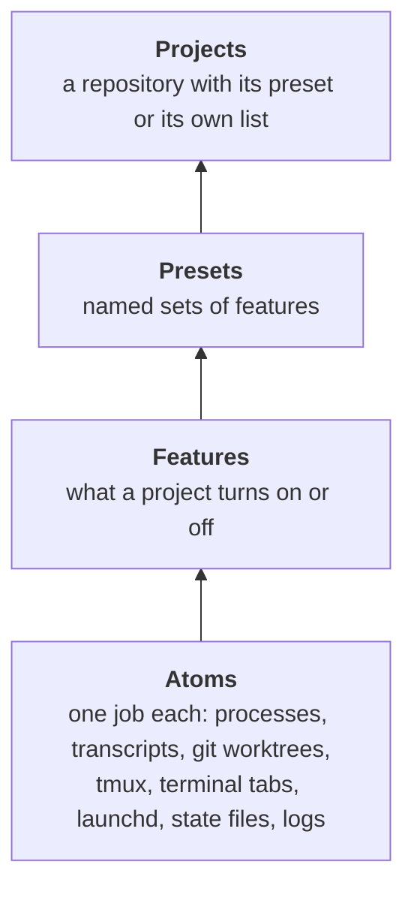

# 

Leave a light on for your phone: porchlight keeps Claude Code sessions ready on your Mac so
you can start, follow and close them from the Claude mobile app.

> **Status: stable.** From 1.0.0, what [Compatibility](#compatibility) lists changes only
> in a major release; the [changelog](CHANGELOG.md) says what each release brings.


Contents: [The problem it solves](#the-problem-it-solves) ·
[Requirements](#requirements) · [Install](#install) · [Quick start](#quick-start) ·
[Documentation](#documentation) ·
[How it works](#how-it-works) · [Features and presets](#features-and-presets) ·
[Troubleshooting](#troubleshooting) · [Development](#development) ·
[Compatibility](#compatibility) · [Contributing](#contributing) · [License](#license)

## The problem it solves

Claude Code's Remote Control lets you drive a session that runs on your Mac from the Claude
mobile app. On its own it leaves four gaps when the phone is the only thing in your hands:

| Without porchlight | With porchlight |
| --- | --- |
| The app cannot start a session that has Claude Code's own interface. Someone has to open a terminal on the Mac first. | A session is always waiting, already connected. You write in it and work starts. |
| A session the app creates through the Remote Control server has no window. On the Mac there is nothing to look at or type in. | A session you use gets a terminal tab, and a session the server started gets a read-only tab that follows it. |
| Archiving a session in the app does not end it on the Mac. Processes, tabs and worktrees pile up. | Archiving closes the tab, ends the session and removes its worktree when nothing in it would be lost. |
| Unarchiving in the app does not bring a session back online. | You ask for it by name from the phone and it comes back in a new tab. |

It serves one project or several, and each one runs only the features you turn on.

## Requirements

- A Mac with [Homebrew](https://brew.sh).
- Claude Code 2.1.92 or later (2.1.327 or later recommended: it stops a server in worktree
  mode without touching its sessions' ignored files), with `claude` in your `PATH`, signed
  in with a claude.ai account on a plan that includes Remote Control: Pro, Max, Ultra,
  Team or Enterprise (on Team and Enterprise an owner turns it on first). Remote Control
  does not work with an API key: with `ANTHROPIC_API_KEY`, `apiKeyHelper` or
  `ANTHROPIC_AUTH_TOKEN` set it stays off. When Claude Code is missing, `setup` can install
  it with Homebrew (`brew install --cask claude-code`); you still sign in by running
  `claude` once. Homebrew formulas cannot depend on casks, so the formula does not
  install it. `claude --version` says which version you have.
- The Claude mobile app, signed in to the same account.
- git: the one in Apple's Command Line Tools or Homebrew's.
- tmux and Python 3.11 or later. The Homebrew formula installs both.
- A terminal for the features that open terminal tabs (`tabs` and `live-view`):
  [Warp](https://www.warp.dev), or Terminal, the app macOS comes with. Without one you can
  still use every other feature.

## Install

```sh
brew install alejandrovdev/porchlight/porchlight
porchlight --version
```

The tap is `alejandrovdev/porchlight`. Installing adds the `porchlight` command; nothing
runs in the background until you link a folder with `porchlight init`.

## Quick start

1. Set up this Mac once:

   ```sh
   porchlight setup
   ```

   Keep the recommended features it starts with: the next steps need `ready-session` and
   `tabs`. Its screens, and the flags that answer them beforehand, are in
   [Setting up porchlight](docs/setup.md).

2. Link a project. Claude Code asks once per folder whether you trust it, and a ready
   session cannot answer that from the phone: if you have never run `claude` in this
   repository, do it once and choose "Yes, I trust this folder". Then, in its folder (a git
   repository), run `init`:

   ```sh
   cd ~/Projects/shop
   porchlight init
   ```

   Then run `porchlight doctor`: each line should say `ok`. The service looks at every
   project every 20 seconds, so the ready session follows within about half a minute.

3. **On the phone**, open the Claude app and tap **Code**. The ready session is in the
   session list, with a computer icon and a green dot while it is online; its name starts
   with the project's name (`shop`). Write in it and work starts.
4. **On the Mac**, with your terminal running, a tab opens on that session soon after your
   first message, and porchlight prepares the next ready session. Archiving the session in
   the app ends it and closes its tab (in Terminal, when its profile closes windows: see
   [A tab does not open](docs/troubleshooting.md#a-tab-does-not-open)).
5. See every project's sessions:

   ```sh
   porchlight status
   ```

   ```text
   shop
     Ready sessions, with Claude Code's interface:
       5f0c9e21  free     2026-11-24 09:41  5f0c9e21  (pid 48211, cse_01Hq7c, hidden)
       a83d2b7c  used     2026-11-24 09:12  Fix the checkout total  (pid 47102, cse_01Xk2m)
     Sessions the server started, with a read-only view:
       No session the server started is running.
   ```

   Each line is one session: its id, its state (`free`, `used` or `closed`), when it last
   changed, its name in the app and where it runs.
   [Reading `status`](docs/commands.md#reading-status) says what each part means.

With the `server` feature on, you can also create new sessions on this Mac from the app.

## Documentation

| Page | What it covers |
| --- | --- |
| [Setting up porchlight](docs/setup.md) | What `setup` and `init` ask and the flags that answer them, unlinking a folder, and uninstalling. |
| [Features](docs/features.md) | What each feature does, in detail. |
| [Configuration](docs/configuration.md) | The configuration file, its keys, what to run after you edit it, and the environment variables. |
| [Commands](docs/commands.md) | Every command, its flags and exit codes, how to read `status`, and what starts and stops the background agents. |
| [How porchlight works](docs/how-it-works.md) | What runs on your Mac, the life of a session, and where its work goes. |
| [Security and privacy](docs/security.md) | What porchlight runs and reads, what it adds to a session, the files it writes and its login agents. |
| [Troubleshooting](docs/troubleshooting.md) | What `doctor`, `status` and the logs tell you, and the common problems with their fixes. |

## How it works

porchlight runs as a service, `porchlight run`, under a login agent: launchd starts it when
you log in and starts it again if it ends. It reads the configuration file, keeps the
sessions of each project running, and follows what happens in them by reading the
transcripts Claude Code writes. Each project with the `server` feature has a login agent of
its own, which runs that project's Remote Control server
(`porchlight server <project> --permission-mode <mode>`) in its repository. porchlight never
talks to Claude's servers itself: every session is an ordinary `claude` process, connected
through Remote Control.

The diagrams, the life of a session from the moment it waits to the moment it is archived,
and what happens to each worktree are in [How porchlight works](docs/how-it-works.md).

## Features and presets

| Feature | What you get | Needs |
| --- | --- | --- |
| `server` | The app creates sessions on the Mac, each in its own worktree | Claude Code, git |
| `ready-session` | A session with Claude Code's interface is always ready to write in | Claude Code, git, tmux |
| `tabs` | A terminal tab opens when a session is used and closes when it is archived | `ready-session`, a supported terminal |
| `live-view` | A read-only tab follows a session the server started | `server`, `tabs` |
| `reopen` | A closed session comes back by name, asked from the phone | `ready-session` |
| `resume-list` | The server's sessions appear in `/resume` | `server` |
| `keep-awake` | The Mac stays awake while porchlight runs, on AC power and on battery | nothing |

The presets are `minimal` (`server`) and `recommended` (all seven).

[Features](docs/features.md) says what each one does in detail.

## Compatibility

From 1.0.0, porchlight follows [Semantic Versioning](https://semver.org): a minor or patch
release keeps working with whatever you built on the following, and only a major release
changes them, with the changelog saying how to move:

- the commands, their options and what they do, and the exit codes: 0 when a command did
  what was asked, 1 when it refused or something needs attention, 2 when the command line
  is wrong;
- the configuration file: where it is, its keys and what they mean (a minor release may add
  an optional key);
- the files and folders porchlight writes, and the labels of its login agents;
- the `PORCHLIGHT_*` environment variables that
  [Configuration](docs/configuration.md#environment-variables) lists.

Not part of it: `porchlight run` and `porchlight server`, which the login agents call; the
wording and layout of what the commands print and of the logs (read them, do not parse
them); and the look of the setup screens.

## Troubleshooting

Start with:

```sh
porchlight doctor
porchlight status
```

`doctor` checks this Mac and, for each project, only what its features need, with what to
do about each problem; its exit code is 1 when something is missing or wrong. What it
prints, the logs, and these common problems are in [Troubleshooting
porchlight](docs/troubleshooting.md):

- [No ready session appears in the app](docs/troubleshooting.md#no-ready-session-appears-in-the-app)
- [A tab does not open](docs/troubleshooting.md#a-tab-does-not-open)
- [A closed tab leaves the session listed in the app](docs/troubleshooting.md#a-closed-tab-leaves-the-session-listed-in-the-app)
- [A session archived in the app keeps running](docs/troubleshooting.md#a-session-archived-in-the-app-keeps-running)
- [`/resume` does not list the server's sessions](docs/troubleshooting.md#resume-does-not-list-the-servers-sessions)
- [The Mac sleeps](docs/troubleshooting.md#the-mac-sleeps)
- [A server uses an old permission mode](docs/troubleshooting.md#a-server-uses-an-old-permission-mode)

## Development

```sh
python3 -m unittest discover -s tests -t .
```

The code uses the Python standard library only (Python 3.11 or later). The tests stand in
for processes, folders, tmux, git and the tab opener: they need no network, no Claude
account and no terminal.

The package is built in layers. An atom knows nothing of features; a feature declares what
it needs and does nothing when it is off; presets name sets of features; a project picks a
preset or its own list.



| Where | What |
| --- | --- |
| `porchlight/atoms/` | the atoms: processes, transcripts, worktrees, tmux, terminal tabs, launchd, state files, logs, file watching |
| `porchlight/features/` | `server`, `ready_sessions` (`ready-session`, `tabs`, `reopen`), `view_tabs` and `live_view` (`live-view`), `resume_list`, `keep_awake` |
| `porchlight/config.py` | the feature table, the presets and the configuration file |
| `porchlight/passes.py`, `service.py` | one pass over the projects, and the service that runs passes |
| `porchlight/agents.py` | the login agents: `apply`, `start`, `stop`, `uninstall` |
| `porchlight/linking.py`, `answers.py`, `screens.py`, `ui/` | `setup`, `init`, `deinit` and the terminal interface |
| `porchlight/doctor.py`, `cli.py`, `names.py`, `mac.py` | the checks, the command line, every name the tool creates, and the Mac as the features see it |

### A rehearsal apart from a real install

The [environment variables](docs/configuration.md#environment-variables) move everything
porchlight names, so a rehearsal never touches an installed copy's files, agents or tmux
server:

```sh
scratch=$(mktemp -d)
export PORCHLIGHT_CONFIG="$scratch/config.toml" PORCHLIGHT_STATE_DIR="$scratch/state" \
  PORCHLIGHT_LOG_DIR="$scratch/logs" PORCHLIGHT_LAUNCH_AGENTS_DIR="$scratch/agents" \
  PORCHLIGHT_LABEL=test.porchlight.rehearsal PORCHLIGHT_TMUX_SERVER=porchlight-rehearsal
porchlight doctor
```

`porchlight` is the installed command; from a clone, `python3 -m porchlight` runs the code
of that clone instead. Keep `PORCHLIGHT_TRANSCRIPTS_DIR` at its default, or porchlight
cannot find Claude Code's transcripts. Run from inside a porchlight session, first
`unset TMUX TMUX_PANE`, so that nothing reaches the tmux server of that session.

Whatever these variables say is handed on to the agents, tabs and sessions porchlight
starts, with folders and files made absolute. The rehearsal is still real where it acts:
`init`, `apply` and `start` load agents into your launchd under the label you chose, its
sessions use your Claude Code account and show in your app, and they need the repository
you link to be trusted by Claude Code (run `claude` in it once). End it with `porchlight
deinit <folder>` and `porchlight uninstall --servers --purge` under the same variables.

## Contributing

Bug reports and pull requests are welcome: see [CONTRIBUTING.md](CONTRIBUTING.md). Report a
vulnerability privately, as [SECURITY.md](SECURITY.md) says.

## License

porchlight is released under the [MIT License](LICENSE).
