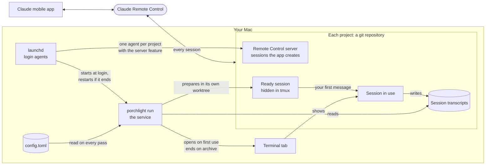
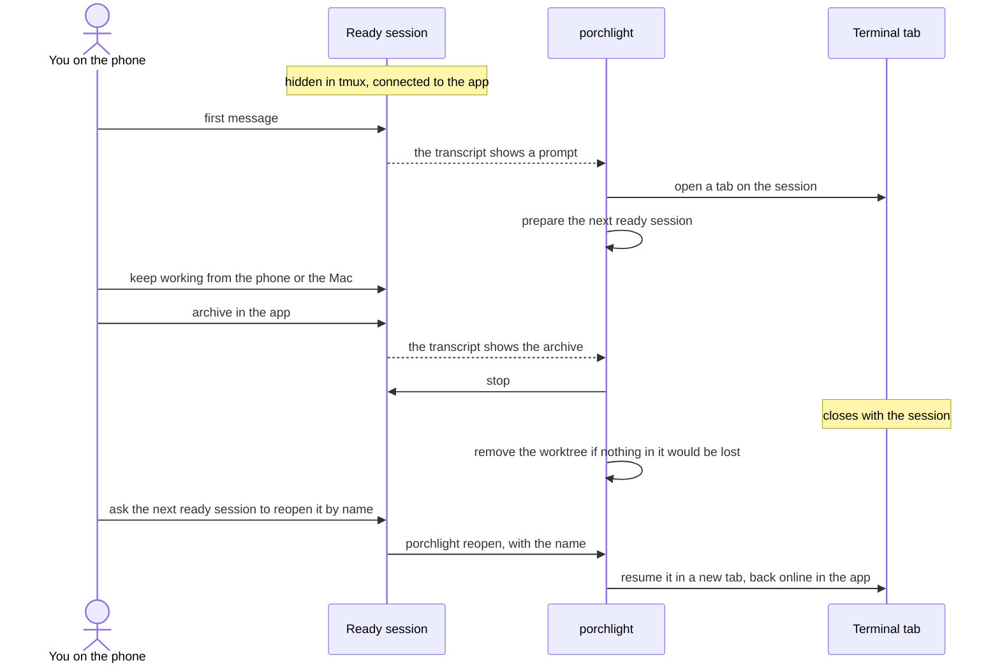

# How porchlight works

Part of [porchlight](../README.md). What runs on your Mac, how a session lives, and where its work goes.

porchlight runs as a service, `porchlight run`, under a login agent: launchd starts it when
you log in and starts it again if it ends. It reads the configuration file, keeps the
sessions of each project running, and follows what happens in them by reading the
transcripts Claude Code writes. Each project with the `server` feature has a login agent of
its own, which runs that project's Remote Control server
(`porchlight server <project> --permission-mode <mode>`) in its repository. porchlight never talks to Claude's servers itself: every session is an
ordinary `claude` process, connected through Remote Control.

The service works in passes. A pass goes over every project: it keeps one ready session
waiting, opens the tab of a session that is now in use, ends a session the app archived,
tidies what ended, opens the read-only tabs of the server's sessions, updates the
`/resume` copies and removes the worktrees the server's ended sessions left, each only for
the projects that have that feature. A pass comes as soon as
the configuration file or a session's transcript changes, and every 20 seconds otherwise
(the process list cannot be watched). A burst of changes makes one pass.

- One project that fails, or whose folder is missing, is written to its log; the others
  still run.
- A configuration file that stops parsing is reported once in the service's log, and the
  last one that parsed keeps being served until the file is fixed.
- Only one service runs at a time. Sessions and tabs keep running when the service restarts.

## The life of a session

Each ready session works in its own git worktree, `.claude/worktrees/porchlight-<project>-<id>`
in the repository, on a branch of the same name that starts from the project's base branch.
Two tasks never share files. When a session ends, its worktree is removed (and its branch
deleted) only if it is clean and everything committed in it is on the base branch;
otherwise it is left where it is for you to pick up, and the project's log says why.
Closing a session's tab ends the session; it then counts as closed, and `reopen` brings it
back.

The Remote Control server gives each of its sessions a worktree too,
`.claude/worktrees/bridge-cse_<id>`, and leaves it there when the session ends. For a
project with `server`, porchlight removes such a worktree by the same rule, once no process
runs its session and neither the worktree nor its transcript has changed for 10 minutes:
only when it is clean (nothing changed, nothing untracked) and its HEAD is on the base
branch. Otherwise it is unlocked and left, and the project's log says why. A locked one is
looked at only when Claude Code locked it (its lock reason starts with `claude `) and no
process that reason names still runs; any other lock is left as it is, still locked, and
the log says so. Its branch was made by Claude Code and is never deleted. porchlight checks
each one once after its session ended, and again only when something in it or in the
repository's branches changed, or when the process that held its lock ended; the log says
why a worktree is left only when that reason is new. It touches nothing else of the
server: a folder of another name, one git does not list as a worktree of the repository,
and any case git cannot answer are left as they are.

The base branch is the project's `base`, else the default branch git recorded for the
repository's `origin`, else, for a repository without `origin`, the branch its main
checkout is on. porchlight does not fetch: a new worktree starts from that branch as your
repository knows it.

